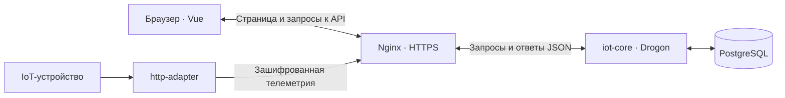

# Как работает фронтенд IoT Studio

IoT Studio — панель для регистрации, входа и просмотра устройств. Браузер
рисует интерфейс на Vue и запрашивает данные у `iot-core`. Сервер проверяет
пароль и сессию, определяет владельца устройства и читает или записывает
данные в PostgreSQL.



## Технологии и точка входа

| Что | За что отвечает | Где смотреть |
| --- | --- | --- |
| HTML | Задаёт название страницы и контейнер `<div id="app">` | [front/index.html](front/index.html#L10) |
| JavaScript и Vue 3 | Хранят состояние экрана и обновляют интерфейс при его изменении | [front/src/main.js](front/src/main.js#L1), [front/src/App.vue](front/src/App.vue#L21) |
| CSS | Определяет зелёную палитру, сетки карточек и расположение элементов на узких экранах | [переменные цветов](front/src/style.css#L1), [адаптивные правила](front/src/style.css#L313) |
| Vite и npm | Устанавливают зависимости, запускают сервер разработки и собирают готовые файлы | [front/package.json](front/package.json#L6), [front/vite.config.js](front/vite.config.js#L6), [package-lock.json](front/package-lock.json) |
| Nginx и Docker Compose | Раздают сборку и пересылают API-запросы через тот же HTTPS-адрес | [front/Dockerfile](front/Dockerfile#L1), [nginx/core-tls.conf](nginx/core-tls.conf#L26), [сервис core-tls](docker-compose.yml#L76) |

Когда открывается страница, браузер загружает `main.js`. Этот файл подключает
стили и вызывает `createApp(App).mount('#app')`, то есть помещает корневой
компонент `App.vue` в контейнер из HTML. Файлы `.vue` содержат
`<script setup>` с логикой на JavaScript и `<template>` с разметкой экрана.
Vite преобразует их в файлы, которые может выполнить браузер.

В компонентах часто встречаются четыре конструкции:

- `ref(...)` хранит изменяемое состояние. Например, `devices` — список,
  полученный с сервера. В JavaScript его меняют через `devices.value`.
- `computed(...)` вычисляет значение из другого состояния. Например,
  `visibleDevices` пересчитывается при изменении списка или фильтра.
- `v-if`, `v-for` и `v-model` показывают нужный блок, создают элементы списка
  и связывают поле ввода с переменной. Так поле поиска обновляет `query`.
- `@click` подписывает кнопку на действие. Дочерний компонент может отправить
  событие родителю через `emit`, как форма отправляет событие `signed-in`
  после входа.

Примеры есть в [состоянии приложения](front/src/App.vue#L21),
[фильтрации списка](front/src/App.vue#L48),
[поле поиска](front/src/App.vue#L214) и
[подключении формы входа](front/src/App.vue#L226).
Переходы между «Обзором», «Устройствами» и «Телеметрией» меняют переменную `view`
через [`navigate()`](front/src/App.vue#L70). Приложение остаётся на адресе
`/app/`, а Vue меняет содержимое страницы.

## Как браузер вызывает API

Все HTTP-запросы проходят через [`request()` в api.js](front/src/api.js#L18).
Внутри используется встроенный браузерный `fetch()`. Функция принимает путь,
метод, тело и при необходимости токен. Она переводит тело в JSON, добавляет
`Authorization: Bearer …`, ждёт ответ до 10 секунд и возвращает разобранный JSON.
Для ответа `204 No Content` возвращает `null`. Ошибки превращаются в
`ApiError` со статусом, а [`errorMessage()`](front/src/api.js#L40) подбирает
текст для пользователя.

Код приложения обращается к путям вроде `/devices`. В Docker браузер получает
и страницу, и ответы API от `https://localhost:8443`. Nginx раздаёт файлы
под `/app/`, а вызовы API пересылает в `iot-core:8080`.
При разработке `/app/` раздаёт Vite. Он проксирует пути `/auth`, `/users`
и `/devices` к локальному HTTPS-входу Nginx и проверяет сертификат через
`certs/ca.crt`. См. [правило Nginx для API](nginx/core-tls.conf#L38) и
[прокси Vite](front/vite.config.js#L9).

## Регистрация, вход и сессия

Режимом формы управляет переменная `step` в
[AuthPanel.vue](front/src/components/AuthPanel.vue#L8). Регистрация проходит так:

1. **Почта.** [`submit()`](front/src/components/AuthPanel.vue#L99) отправляет
   `POST /auth/register/start` с полем `mail`. В ответ приходят ссылка на бота,
   короткоживущий токен регистрации и срок действия. Форма сохраняет попытку
   как `iot2.registration` в `sessionStorage`. Эту же вкладку можно
   перезагрузить и продолжить оформление.
2. **Telegram.** Пользователь открывает ссылку и нажимает «Старт».
   [`TelegramNotifier::handleStart()`](iot-core/src/notifications/TelegramNotifier.cpp#L54)
   получает ID отправителя из личного чата. Во фронтенде
   [`checkTelegram()`](front/src/components/AuthPanel.vue#L57) вызывает
   `GET /auth/register/status` с токеном регистрации. Проверка запускается
   каждые три секунды, пока вкладка видима и открыт шаг Telegram. При
   `telegram_confirmed: true` форма открывает поле пароля.
3. **Пароль.** Форма отправляет [`POST /users`](front/src/components/AuthPanel.vue#L125)
   с паролем и токеном регистрации. Сервер проверяет, что срок попытки в
   десять минут ещё не истёк и бот её подтвердил. Затем он создаёт пользователя
   с Telegram ID из попытки и завершает её. Форма очищает временную запись и
   предлагает войти. См. [проверку на сервере](iot-core/src/routes/user_routes.cpp#L117)
   и [запись аккаунта в БД](iot-core/src/repositories/user_repository.cpp#L62).

Email в этом сценарии служит логином. Подтверждение касается аккаунта Telegram.
У ссылки бота и токена регистрации разные значения. Подробности о хешировании
паролей, соли и перце есть в [спринте 5](sprint5_sol_and_peper.adoc).

Для входа форма посылает email и пароль на `POST /auth/login`. Сервер проверяет
пароль, выдаёт токен сессии на 24 часа, а форма передаёт его в `App.vue` через
`emit('signed-in', result.token)`. Обработчик
[`signedIn()`](front/src/App.vue#L132) сохраняет токен как `iot2.session`
в [`sessionStorage`](front/src/api.js#L1) и загружает профиль и устройства.
Токен переживает перезагрузку вкладки. Пароль используется при отправке формы
и в `sessionStorage` не записывается.

При выходе [`logout()`](front/src/App.vue#L138) вызывает `POST /auth/logout`,
после чего `clearSession()` удаляет токен и данные аккаунта из состояния.
Если защищённый запрос получает `401`, приложение возвращается к форме входа.
Решение о доступе принимает сервер. Его
[`UserAuthFilter`](iot-core/src/services/auth.cpp#L159) находит действующую
сессию по хешу токена и передаёт ID пользователя обработчику. Новый вход
заменяет предыдущую сессию. См. [выдачу токена](iot-core/src/routes/user_routes.cpp#L148)
и [обработку `401` на фронтенде](front/src/App.vue#L91).

## Что происходит при добавлении устройства

Кнопка «Добавить устройство» открывает HTML-диалог через
[`showCreate()`](front/src/App.vue#L152). При отправке
[`createDevice()`](front/src/App.vue#L160) убирает пробелы по краям названия
и отправляет короткий запрос:

```js
const device = await request('/devices', {
  token: currentToken,
  method: 'POST',
  body: { name, notifications_enabled: notifications.value },
})
```

В запросе есть название и флаг уведомлений. ID владельца сервер берёт из
сессии. [Обработчик `POST /devices`](iot-core/src/routes/device_routes.cpp#L60)
передаёт его в [репозиторий](iot-core/src/repositories/device_repository.cpp#L29),
который создаёт устройство и связь с пользователем. В ответе `201 Created`
приходит созданный объект. Vue добавляет его в `devices.value` и сразу
показывает новую карточку. Эта цепочка объясняет, как интерфейс узнаёт
настоящий ID устройства и почему клиент не выбирает владельца.

## Откуда берутся карточки, история и графики

- [`refresh()`](front/src/App.vue#L112) загружает `GET /devices`. Первый
  запрос после входа также получает профиль из `GET /users`. Сервер
  [возвращает только устройства владельца](iot-core/src/repositories/device_repository.cpp#L46),
  а внутри каждого устройства уже есть массив `telemetry`, начиная с самого
  свежего измерения. Поиск и фильтры работают с этим списком в браузере.
- [`DeviceCard.vue`](front/src/components/DeviceCard.vue#L6) получает объект
  устройства через `props`, берёт первый элемент `telemetry` и показывает
  последние значения. При клике карточка отправляет событие `open` с ID.
  [`openDevice()`](front/src/App.vue#L79) записывает выбранный ID, а
  [страница устройства](front/src/App.vue#L251) показывает его показания.
  Статус «Есть данные» означает, что хотя бы одно измерение сохранено.
- [`ReadingTable.vue`](front/src/components/ReadingTable.vue#L12) выводит
  время и значения измерений. Детали устройства показывают до 30 записей.
  Вкладка «Телеметрия» объединяет записи подходящих устройств, сортирует
  по времени и оставляет последние 30 для общего списка.
- [`chartFor()`](front/src/telemetry.js#L40) смотрит на последние 40 записей,
  берёт числовые значения выбранного поля и переводит их в координаты
  для SVG. График появляется после двух числовых значений. По горизонтали
  точки идут по порядку измерений с одинаковым шагом. Их отступы не показывают
  реальные интервалы времени.

Ограничения в 30 и 40 записей применяются при отображении. Текущий
[`GET /devices`](iot-core/src/repositories/device_repository.cpp#L9)
возвращает всю сохранённую телеметрию устройств пользователя.

Браузер сам запрашивает новые данные каждые 15 секунд, пока вкладка видима.
Это называется **опросом**. При возвращении на вкладку обновление также
запускается через событие `visibilitychange`. Кнопка «Обновить» позволяет
вызвать его вручную. См. [таймер обновления](front/src/App.vue#L188).

Измерения приходят отдельным путём. Датчик отправляет `device_id` и `data`
в [`POST /telemetry` адаптера](http-adapter/src/main.cpp#L94), адаптер шифрует
пакет и пересылает его в ядро. Ядро сохраняет измерение. Панель видит
новое значение при следующем `GET /devices`.

## Как запустить и быстро показать работу

Из корня проекта запустите `docker compose up --build -d` и откройте
[https://localhost:8443/app/](https://localhost:8443/app/). Для регистрации нужен
токен Telegram-бота в `.env`. Чтобы править фронтенд с быстрым обновлением,
оставьте Docker запущенным и выполните `npm ci --prefix front`, затем
`npm run dev --prefix front`. Настройка сертификата и пример тестовой отправки
измерения есть в [front/README.md](front/README.md).

Для демонстрации откройте в инструментах браузера **Network → Fetch/XHR**.
Войдите в аккаунт, добавьте устройство и нажмите «Обновить». Вы увидите
`POST /auth/login`, `POST /devices` и `GET /devices`. Сравните JSON ответа
с тем, что появилось на экране. Токен при демонстрации держите скрытым.

Если нужно объяснить проект за минуту, можно сказать так:

> Vue рисует интерфейс и хранит текущее состояние экрана. Все запросы проходят
> через одну функцию на `fetch`. Для регистрации сервер связывает почту и
> Telegram, а после входа выдаёт токен сессии. По этому токену сервер узнаёт
> владельца и отдаёт только его устройства. Датчики отправляют измерения через
> отдельный адаптер, а браузер периодически запрашивает список и строит графики
> из новых данных.
